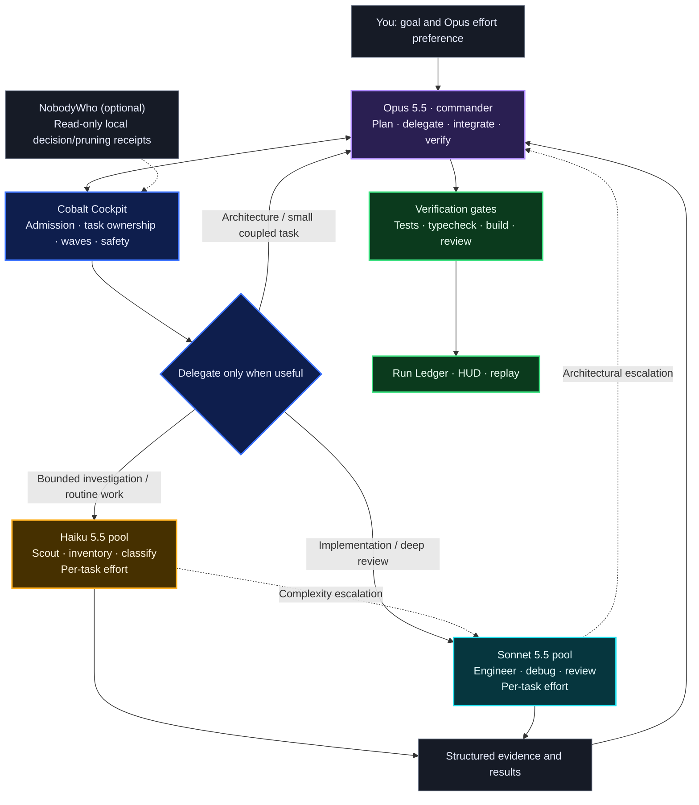
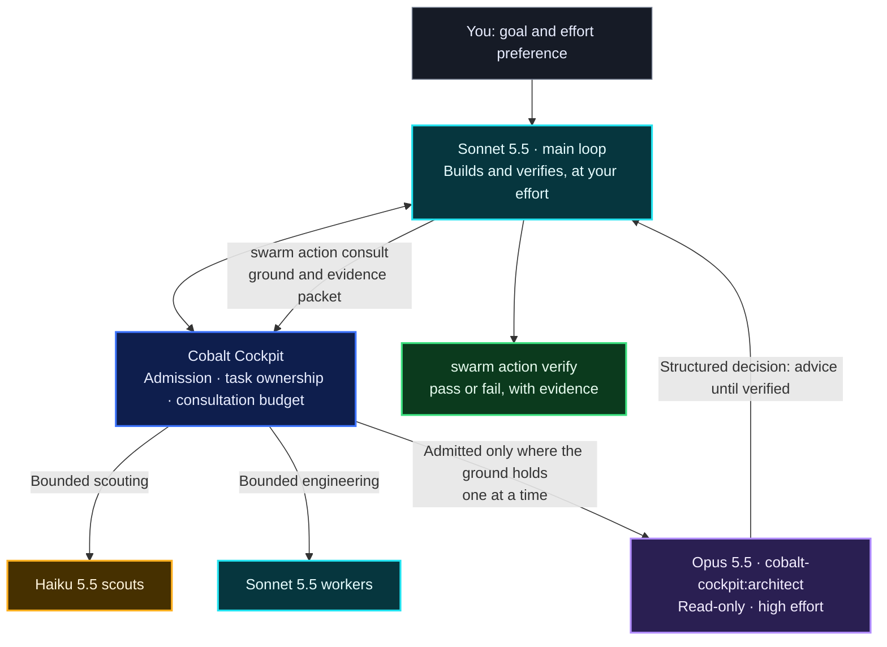

<h1 align="center"><picture><source media="(prefers-color-scheme: dark)" srcset="docs/assets/hero/cockpit-hero-dark.svg"><source media="(prefers-color-scheme: light)" srcset="docs/assets/hero/cockpit-hero-light.svg"></picture><br><sub>Cobalt Cockpit — Mission Control for Claude Code</sub></h1>

<p align="center">
  <a href="#system-overview">Overview</a> ·
  <a href="#live-interface">Live interface</a> ·
  <a href="#mission-control-modules">Modules</a> ·
  <a href="#swarm-architecture">Swarm</a> ·
  <a href="#quick-start">Quick start</a> ·
  <a href="#explore-commands">Commands</a> ·
  <a href="#safety-and-trust">Safety</a> ·
  <a href="#capabilities-at-a-glance">Disclosures</a> ·
  <a href="#deep-documentation">Docs</a>
</p>

<p align="center">
  <a href="https://github.com/echelong/cobalt-cockpit/actions/workflows/ci.yml"></a>
  <a href="https://github.com/echelong/cobalt-cockpit/actions/workflows/secret-scan.yml"></a>
</p>

<p align="center"><sub><a href="LICENSE">MIT</a> · <a href="PRIVACY.md">Privacy</a> · <a href="SECURITY.md">Security</a> · <a href="CHANGELOG.md">Changelog</a></sub></p>

**Mission control for Claude Code.** Follow real task progress, coordinate bounded subagents, review verification gates, and replay what happened, without replacing Claude Code's native model and permission controls.

```sh
claude plugin marketplace add echelong/cobalt-cockpit
claude plugin install cobalt-cockpit@cobalt-cockpit
```

Restart Claude Code and open `/cockpit`. Requirements, first run and options: [Quick start](#quick-start).

## System overview

Cobalt Cockpit adds a cyberpunk HUD, orchestration controls, and a local Run Ledger to Claude Code. It tracks **observed** milestones and verification rather than inventing progress. With orchestration enabled, Opus coordinates bounded Sonnet engineering and Haiku utility tasks, each with task-aware reasoning effort. The dashboard itself makes no model calls.

- **Observe by default.** With `orchestration: false`, Cockpit observes your existing Claude Code activity without enforcing model routing, subagent budgets, Fable blocking, or subscription-only authentication.
- **Enforce by opt-in.** `orchestration: true` enforces the Opus/Sonnet/Haiku policy, independent pool resource budgets, and explicit task ownership. `blockFable`, `subscriptionOnly`, `cobaltStrict`, the Stop-hook guard and owner alerts are separate switches, each off until you turn it on.
- **Evidence before DONE.** A completed turn does not complete a task. A task reads 100% and DONE only when every milestone is complete and every required gate is pass or n/a; a coding task above the LIGHT discovery level also needs its goal check to report `ALIGNED`. Missing measurements stay unknown.
- **Never an approval.** Cockpit does not take part in Claude Code's permission check. Its guards run before it and can only refuse a call or ask you about it, never approve one.
- **Local, with one exception you choose.** It makes no network request of its own: no fetch, no model call, no MCP call. The one program it starts that can is the decision router in JEV mode, in a session where you selected it ([Session router](#session-router)). Its two prompt hooks add text to the request Claude Code already sends. The Run Ledger and the local model telemetry are local, and the telemetry is on by default.

<details>
<summary><b>Full feature list</b></summary>

- VECTOR / Activity Field, milestone progress, verification-gated DONE, context usage and Git/activity tracking.
- Dynamic, task-aware reasoning effort: AUTO selection, a commander-named level per assignment, an operator ceiling and capability fallback, with requested and applied effort kept apart.
- Main and subagent orchestration telemetry, subagent radar, observed model/effort and token usage.
- Local Run Ledger, sanitized JSON export, bounded replay, and park/resume checkpoints.
- Blast-radius protection, repository hygiene, optional sounds and hot reload persistence.
- Fail-closed guards: a hook that cannot reach its decision refuses the action it guards rather than letting it run, and every such decision is judged against the event it was given.
- Narrow-terminal and reduced-motion layouts; preserves the engine's image viewer.
- Optional read-only NobodyWho telemetry and opt-in orchestration policy enforcement.
- Optional Sonnet-led profile (`profile: SONNET_LED`): Sonnet 5.5 is the main model at your effort, and Opus 5.5 runs at High only as an admitted, read-only architect consultation. `OPUS_LED` stays the default.
- Optional per-session router (`/cockpit router`): OFF by default, NobodyWho (local) or JEV (TypeSafe API) for advisory routing recommendations. Cockpit's deterministic rules stay authoritative.
- Read-only helpers can deliver their reports: a bound helper may use the host's tool discovery and report hand-back without gaining any write, shell or delegation right, and each task records how its report arrived.

The fail-closed rule has one structural exception, `turn.step`: see [SECURITY.md](SECURITY.md#hooks-that-refuse).

</details>

## Live interface

<p align="center">
  <picture>
    <source media="(prefers-reduced-motion: reduce)" srcset="docs/assets/demo/cockpit-demo-poster.png">
    
  </picture>
</p>

**Synthetic demo, genuine output.** The HUD band, the panes, the command output and the tool replies in this loop were captured from Cockpit v0.6.1's own render hooks, commands and tools (the plugin code at the commit named in `docs/assets/demo/frames.json`; the loop is regenerated on request, not for each release, so its on-screen version is the version it was captured from), run in Claude Code's offline plugin test host (`claude plugin test`) against a scripted task; the Bash results are the test host's scripted answers. No model ran and no live session was recorded. The frame, the captions, the call labels, the typed command line and the timing are presentation.

[Static frame](docs/assets/demo/cockpit-demo-poster.png) · [How it was captured, and how to regenerate it](docs/assets/README.md) · [The captured frames as data](docs/assets/demo/frames.json)

On a narrow screen the loop is small: open the static frame, or read the main frames as text in the panels below.

<details>
<summary><b>What is scripted, and what is the test host's</b></summary>

- **The calls are scripted.** The prompt, the `progress` and `swarm` tool calls, the agent spawns and reports and every evidence string are written in [the capture script](docs/assets/src/demo-capture.ts). In a live session the model makes those calls; here Cockpit's replies to them are what is shown.
- **The test host answers for the outside world.** The failing `npm test` is the host's scripted `Exit code 1`, and `notification SENT` is its answer to the notification Cockpit asked for: nothing reached a terminal. Agent ids read `spawned-`, the context meter is fixed at `CTX 39%`, and the clock starts near the Unix epoch.
- **What the builder does to fit the screen.** A tool reply is reflowed to the 100-column grid and cut where marked `[...]`; a pane is shown from its first row to the height of the window. HUD rows and command output are drawn as captured, character for character.
- **Colour.** In a terminal the HUD's own accent is red, as the loop shows; cobalt is the colour of this page.

</details>

<details>
<summary><b>Read the captured frames as text</b></summary>

The HUD band while a scout and two engineers run and a reviewer waits for them (100 columns; the `SWARM:` row is shown because that task is blocked; the last three rows are the per-agent strips). How the Braille and box-drawing rows line up depends on your font; the animation shows them exactly:

```text
OPUS ENGINEERING ─╼─ SONNET ×3 2 active !1 0 queued 0 done ─╼─ HAIKU ×1 1 active 0 queued 0 done
◆────────────────────◆───━╲╲◉╮─────────────────────────────────◆────────────────────────────────────
▐▓▌ Add per-client ra…      IMPLEMENT◉─━─│─━─━─━───────│────────────│───────◆─◆─◆─│─◆─◆────────╴ 20%
TEST ·  TYPE ·  BUILD ·  GIT ·   CTX 39%   THINK +3 agents   opus-5-5
● INPUT ⠶⠶⠶⠶⠶⠶⠶⠶ ● DISCOVERY ⠶⠶⠶⠶⠶⠶⠶⠶ ● ROUTING ⣤⣶◆⠶⣤⣶◆⠶ ◎ WORKERS ⠤⠤⠤⠤⠤⠤⠤⠤ ○ VERIFY ⠤⠤⠤⠤⠤⠤⠤⠤ ○ DONE
GUARD: ARMED · transport not confirmed · /cockpit guard test
SWARM: 1 BLOCKED · /cockpit agents
OPUS / MAIN · IMPLEMENT   HAIKU+SONNET / SUBAGENTS 3/16
                       01 scout       READ        13s · 1 tools      ⡬   ⡫    ⢗ ⡔   ⢱  ⠑⠞⣊⠹
                       02 worker      EDIT        9s · 1 tools       ⡬   ⡫    ⢗ ⡔   ⢱  ⠑⠞⣊⠹
                       03 worker      EDIT        9s · 1 tools       ⡬   ⡫    ⢗ ⡔   ⢱  ⠑⠞⣊⠹
```

The top of Mission Control (`/cockpit`) once the task is verified (its first 27 rows):

```text
━ VECTOR  CONSOLE / MISSION
 STATE / VERIFIED  THINK

01 TASK ───────────────────────────────────────────────────────────────────────────────────────────
 Goal         Add per-client rate limiting to the API gateway
 Kind         coding  5 milestones
 Started      33s ago  updated 1s ago

02 PROGRESS ───────────────────────────────────────────────────────────────────────────────────────
 Phase        DONE  ████████████████████████  100%
 Milestones   5/5  DONE
 Latest       4s ago  BUILD npm run build

03 MILESTONES ─────────────────────────────────────────────────────────────────────────────────────
  ✓ m1  Inspect gateway middleware  INSPECT
  ✓ m2  Implement token-bucket limiter  IMPLEMENT
  ✓ m3  Write limiter tests  TEST
  ✓ m4  Fix failures  FIX
  ✓ m5  Verify  VERIFY

04 VERIFICATION ───────────────────────────────────────────────────────────────────────────────────
  ✓ CODE      pass     src/limiter.ts and tests/limiter.test.ts reviewed by REV-1, no open findings
  ✓ TEST      pass     npm test (exit 0)
  ✓ TYPE      pass     npx tsc --noEmit (exit 0)
  ✓ BUILD     pass     npm run build (exit 0)
  – SECURITY  n/a      no new dependency, no secret, no auth path touched
  ✓ GIT       pass     git status: only src/limiter.ts and tests/limiter.test.ts changed
```

</details>

## Mission Control modules

<p align="center">
  <a href="#agent-orchestration"><picture><source media="(prefers-color-scheme: dark)" srcset="docs/assets/modules/01-swarm-dark.svg"><source media="(prefers-color-scheme: light)" srcset="docs/assets/modules/01-swarm-light.svg"></picture></a>
  <a href="#neural-flow-and-progress"><picture><source media="(prefers-color-scheme: dark)" srcset="docs/assets/modules/02-flow-dark.svg"><source media="(prefers-color-scheme: light)" srcset="docs/assets/modules/02-flow-light.svg"></picture></a>
  <a href="#agent-inspector"><picture><source media="(prefers-color-scheme: dark)" srcset="docs/assets/modules/03-inspect-dark.svg"><source media="(prefers-color-scheme: light)" srcset="docs/assets/modules/03-inspect-light.svg"></picture></a>
  <a href="#verification-readiness"><picture><source media="(prefers-color-scheme: dark)" srcset="docs/assets/modules/04-ready-dark.svg"><source media="(prefers-color-scheme: light)" srcset="docs/assets/modules/04-ready-light.svg"></picture></a>
  <a href="#cobalt-guard"><picture><source media="(prefers-color-scheme: dark)" srcset="docs/assets/modules/05-guard-dark.svg"><source media="(prefers-color-scheme: light)" srcset="docs/assets/modules/05-guard-light.svg"></picture></a>
  <a href="#run-ledger-and-replay"><picture><source media="(prefers-color-scheme: dark)" srcset="docs/assets/modules/06-ledger-dark.svg"><source media="(prefers-color-scheme: light)" srcset="docs/assets/modules/06-ledger-light.svg"></picture></a>
</p>

Each key links to its module below. The captured blocks inside the panels come from the same synthetic demo as the animation.

### Agent orchestration

`MODULE 01` `swarm tool` `orchestration: true` `default: observe`

Opus remains the single commander: architecture, planning, decomposition, integration, escalation decisions and final verification. Sonnet engineers substantial bounded changes and independent reviews. Haiku scouts repositories and processes extractive, repetitive work. Small or tightly coupled work stays in the main session.

- **Assigned before spawned.** The `swarm` tool records bounded assignments before spawning. Each assignment carries a task ID, parent, tier, semantic role, objective, scope, dependencies, resource ownership, read/write mode and spawn reason.
- **Admission, not fan-out.** Queued tasks wait for resource capacity; blocked tasks wait for dependencies; intersecting write scopes are serialized. Read-only scopes may overlap.
- **Bounded tools.** Scoped agents use Read/Grep/Glob for inspection and Edit/Write for changes. Shell or custom tools require exclusive wildcard ownership, except read-only Git inspection: a task that owns named paths can run `git diff`, `show`, `log`, `status`, `grep` and `ls-files` on those paths and nothing else ([the exact rules](docs/implementation-v0.6.1.md#scoped-read-only-git-inspection)). The command that runs is rebuilt behind safe flags, and your own permission rules still decide it.
- **A route suggestion, not a router.** Each assignment records the tier Cockpit's own rule would suggest (from the mode, the role's class, a named effort and the wave). The commander's tier stands; `/cockpit agents` shows suggested, requested, admitted, spawned, completed and verified per tier.
- **A line when the swarm needs you.** With orchestration enforced, while a task is blocked, quiet or escalated the HUD gives one of its agent-strip rows to a static line, `SWARM: 2 BLOCKED · 1 QUIET 5m+ · 1 ESCALATED · /cockpit agents`, and no row otherwise. QUIET is the swarm's stalled mark: no activity observed for the threshold, which is not a stopped agent.
- **Reported is not verified.** Agents return concise conclusion/evidence/change/check/uncertainty artifacts; commanders verify claims independently.

<details>
<summary><b>Explore the swarm</b></summary>

Two replies from the demo. The first line of each pair is the synthetic call; the indented line is what Cockpit answered. The reviewer depends on both engineers, so its spawn is refused until they finish:

```text
swarm assign ENG-1 (SONNET worker)
  Task ENG-1 queued; use Agent description [task:ENG-1]. OPUS tasks stay in main.
Agent [task:REV-1] cobalt-cockpit:reviewer
  {"deny":"SWARM / queued REV-1: dependency ENG-1: running; retry after dependency/ownership/resource clears"}
```

Run waves are reconnaissance → engineering → review → integration → verification. Waves are observable phases; they do not replace dependency checks. Ownership rules, queueing, escalation, cancellation and adoption in full: [docs/orchestration.md](docs/orchestration.md).

</details>

### Neural Flow and progress

`MODULE 02` `/cockpit flow` `/cockpit status` `on by default`

One row of the HUD: `INPUT → DISCOVERY → ROUTING → WORKERS → VERIFY → DONE`. Every state comes from the task's real milestones and gates and the agents the host reported; the moving marker is drawn only while work is live. Reduced motion and narrow terminals are honoured. Amber is Haiku, cyan Sonnet, violet Opus, green a verified result, and each state is also carried by its glyph, never by colour alone. Evidence that goes stale regresses the flow by itself: a gate that reverts to pending takes VERIFY back to active and DONE back to pending.

Progress is completed milestones over all milestones. The HUD is in one of six states:

| State | Meaning |
| --- | --- |
| IDLE | No active work |
| SCAN | Main loop working without a tool in flight |
| ACTIVE | Tool or agent activity observed |
| QUERY | Waiting on a question put to you, or on one of Cockpit's own asks. Claude Code's permission dialog is not tracked |
| FAULT | Failure or blocker |
| VERIFIED | Milestones complete and required gates satisfied |

A completed turn does not complete a task. Missing measurements stay unknown.

<details>
<summary><b>Read the flow in words</b></summary>

`/cockpit flow` prints the row for a surface without colour. While the engineers run:

```text
FLOW  ● INPUT → ● DISCOVERY → ● ROUTING → ◉ WORKERS → ○ VERIFY → ○ DONE
verified INPUT, DISCOVERY, ROUTING · active WORKERS · pending VERIFY, DONE
observed running: HAIKU 1 · SONNET 2 · work is live · main model OPUS
```

After verification:

```text
FLOW  ● INPUT → ● DISCOVERY → ● ROUTING → ● WORKERS → ● VERIFY → ● DONE
verified INPUT, DISCOVERY, ROUTING, WORKERS, VERIFY, DONE
no agent observed running · work is live · main model OPUS
```

</details>

### Agent Inspector

`MODULE 03` `/cockpit agents` `/cockpit agents <task>` `read-only`

Three read-only views of what Cockpit already records about multi-agent work. None of them changes state, starts, admits or cancels an agent, or clears a hold; none invents a figure the host did not report. The first two are here; the third is [Verification Readiness](#verification-readiness).

- **`/cockpit agents`** lists the swarm's tasks, the ones that need attention first (stalled, escalated, blocked, queued), with the wave, the capacity in use (`3 of 4 slots · SONNET 2/2 · HAIKU 1/2`), the delegation funnel per tier (`ROUTE HAIKU · suggested 1 · requested 1 · admitted 1 · spawned 1 · completed 0 · verified 0`: six separate facts), and the host agents Cockpit did not assign. **`/cockpit agents <task>`** shows one task: objective, bound agent, model as observed (or "not observed"), the tier the route suggested beside the one the commander requested, effort as requested, as set on the launch, as applied and as the engine reported (four different things, each "not observed" when it was not), wave, ownership (shortened claims), dependencies, children, last observed activity, the outcome as reported versus as verified by the commander, any escalation, and the blocker.
- **Blockers** are explained from the swarm's own admission rule, not a second scheduler: waiting for another task, a resource ownership conflict (and over what), agent capacity exhausted (with the numbers admission uses), the commander or an architect occupied, a reservation waiting for the host, a stall (ownership retained), an escalation awaiting the commander, a cancellation awaiting the host, a failure, or a completed result not yet verified. A suggestion is labelled **information only; nothing was changed**, and appears only when the recorded state supports one.

<details>
<summary><b>Inspect a task</b></summary>

`/cockpit agents` while three agents run and one waits:

```text
AGENTS · wave ENGINEERING · 3 active · 1 waiting · 0 stalled · 0 escalated · 0 completed of 4
CAPACITY · 3 of 16 slots · SONNET 2/8 · HAIKU 1/16 · OPUS in the main loop
ROUTE HAIKU · suggested 1 · requested 1 · admitted 1 · spawned 1 · completed 0 · verified 0
ROUTE SONNET · suggested 3 · requested 3 · admitted 2 · spawned 2 · completed 0 · verified 0
  REV-1 SONNET reviewer · blocked · no agent · none: not started
    ↳ Waiting for task ENG-1 (running).
  ENG-1 SONNET worker · running · agent spawned- · last observed just now
  ENG-2 SONNET worker · running · agent spawned- · last observed just now
  SCOUT-1 HAIKU scout · running · agent spawned- · last observed just now
Read-only. /cockpit agents <task> explains one; /cockpit ready, what is left before DONE.
```

`/cockpit agents REV-1`, the task that waits:

```text
TASK REV-1 · SONNET reviewer · blocked
objective: Review the limiter and its tests against the criteria
agent: none bound
model: SONNET assigned; model not observed (no agent bound)
route: SONNET, as the route suggested (independent review needs engineering judgement)
effort: requested AUTO · launch: none set on the call · applied: not observed
wave: ENGINEERING
owns: read …/src/limiter.ts, …/tests/limiter.test.ts
depends on: ENG-1 running · ENG-2 running
activity: none: not started
outcome: none yet
blocker (dependency): Waiting for task ENG-1 (running).
suggestion (information only; nothing was changed): Wait for ENG-1; /cockpit agents ENG-1 shows whe…
```

`/cockpit agents` later: every agent has reported, and only the result the commander checked is verified:

```text
AGENTS · wave ENGINEERING · 0 active · 1 waiting · 0 stalled · 0 escalated · 3 completed of 4
CAPACITY · 0 of 16 slots · SONNET 0/8 · HAIKU 0/16 · OPUS in the main loop
ROUTE HAIKU · suggested 1 · requested 1 · admitted 1 · spawned 1 · completed 1 · verified 0
ROUTE SONNET · suggested 3 · requested 3 · admitted 2 · spawned 2 · completed 2 · verified 1
  REV-1 SONNET reviewer · blocked · no agent · none: not started
    ↳ Nothing recorded stops it: it is admissible now and has not been admitted.
  ENG-1 SONNET worker · completed · agent spawned- · ended just now
  ENG-2 SONNET worker · completed · agent spawned- · ended just now
    ↳ reported by the agent; NOT verified (pending)
  SCOUT-1 HAIKU scout · completed · agent spawned- · ended just now
    ↳ reported by the agent; NOT verified (pending)
Read-only. /cockpit agents <task> explains one; /cockpit ready, what is left before DONE.
```

</details>

### Verification Readiness

`MODULE 04` `/cockpit ready` `read-only` `approves nothing`

- **`/cockpit ready`** applies the existing completion rules to the recorded task: open milestones and blockers, the six gates (a pass reported by Claude is labelled as such and never called verified; a pass that went stale is STALE), the Stop guard's hold or missing completion, an unadjudicated Opus review, the goal check's acceptance criteria and open unknowns, and, as notes, pending agent escalations and reported-but-unverified agent results. It says `PERMITS DONE` exactly when the task's own status is DONE, and is otherwise `DOES NOT PERMIT DONE` with what stands in the way. It is an explanation, not an approval.

The six gates are CODE, TEST, TYPE, BUILD, SECURITY and GIT. Verification gates use observed exit status and explicit reported evidence, not proof of correctness. A coding task above LIGHT cannot read DONE until `align` reports `ALIGNED`: each acceptance criterion needs its own evidence, and for that goal-checked work an observed edit after DONE takes completion back (what can go unobserved is listed in [docs/verification.md](docs/verification.md)).

<details>
<summary><b>Understand verification</b></summary>

`/cockpit ready` after a scripted failing test command:

```text
READY · DOES NOT PERMIT DONE · 40% · status ACTIVE
STANDING IN THE WAY
  ✗ milestones 2 of 5 done · open: m3 Write limiter tests [pending]; m4 Fix failures [active]; m5 V…
  ✗ CODE not reported yet
  ✗ TEST FAILED · npm test (failed)
  ✗ TYPE not reported yet
  ✗ BUILD not reported yet
  ✗ SECURITY not reported yet
  ✗ GIT not reported yet
  ✗ goal alignment PENDING · acceptance criteria 0 of 3 met with evidence
ALSO
  · 2 agent results reported, not verified: SCOUT-1 (pending), ENG-2 (pending)
  · 1 agent task waiting or stalled: REV-1 blocked · /cockpit agents explains why
Read-only: approves nothing, clears nothing; a reported result is not a verified one.
```

`/cockpit ready` after the commands pass, the agent results are verified and the goal check is aligned:

```text
READY · PERMITS DONE · 100% · status DONE
HOLDS
  ✓ milestones 5 of 5 done
  ✓ CODE pass · reported by Claude, not read from a command
  ✓ TEST pass · read from a command
  ✓ TYPE pass · read from a command
  ✓ BUILD pass · read from a command
  ✓ SECURITY n/a · no new dependency, no secret, no auth path touched
  ✓ GIT pass · reported by Claude, not read from a command
  ✓ goal check ALIGNED · acceptance criteria 3 of 3 met with evidence (evidence is as reported; its…
Read-only: approves nothing, clears nothing; a reported result is not a verified one.
```

The completion gate is a hold on the progress model, not a proof of correctness. Discovery levels, decision records, the goal check, what happens after DONE and the full list of limits: [docs/verification.md](docs/verification.md).

</details>

### Cobalt Guard

`MODULE 05` `/cockpit guard` `/cockpit alerts` `opt-in`

Cobalt Guard tells a person when a run needs one, and can hold a stop until your own check passes. Both parts are off until you turn them on.

- **Owner alerts** (`guardAlerts`, off by default). When on, a terminal notification (through Claude Code's own notification channel) tells you when a run needs a person: verification retries exhausted, a security check failed, a release NO-GO, an open mandatory review, or a blocked run. It never approves, releases or clears anything, and it cannot confirm that you saw it. No webhook, email or push.
- **The alert inbox.** `/cockpit alerts` lists what Cobalt Guard recorded, so you can recover it after stepping away. With `guardRecordOnly` on and alerts off, incidents are written down for `/cockpit alerts` and the digest; no notification, sound, bell or reminder is ever sent for them.
- **Calibration** (v0.6.3). `/cockpit alerts review`, `label` and `calibration` let you say which recorded incidents you would have wanted a notification for, and report how the alert policy would have done against your labels, as a simulation that sends nothing. It is an evaluation, not an automatic optimizer: it changes no setting, no notification and no enforcement. Details: [docs/implementation-v0.6.3.md](docs/implementation-v0.6.3.md).
- **Stop-hook verification guard** (`stopGuard`, `OBSERVE` by default). `ENFORCE` runs your `verifyScript` when the agent tries to finish a task that changed files, and refuses the stop (up to the attempt limit) until the script exits 0. The script is not trusted until you enroll its sha-256 with `/cockpit guard trust`; it is re-hashed before every run and a changed script is not run.
- **No verdict changes.** An alert, a reminder, an acknowledgment or a silence never changes a gate, a hold, a review, a release approval or the task's percentage.

Two command guards are on by default and are described under [Safety and trust](#safety-and-trust): the blast-radius guard and the attribution guard.

<details>
<summary><b>Configure Guard</b></summary>

The Stop guard's and the alerts' settings are the person's alone: they are accepted only from you in the config menu (`/config`), never from a plugin or a model.

| Option | Default | Meaning |
| --- | --- | --- |
| `guardAlerts` | `false` | Owner alerts through the host's terminal notification |
| `guardCooldownSec`, `guardMaxAlerts` | `300`, `5` | Minimum time between alerts (minimum 30); most alerts one session may raise, reminders included (maximum 20) |
| `guardRepeat`, `guardRepeatSec`, `guardMaxReminders` | `false`, `900`, `3` | Persistent alerts (needs `guardAlerts`); time between reminders (minimum 60); reminders per condition (maximum 10) |
| `guardSound` | `false` | Tries the checkpoint cue, or the terminal bell, with each alert (needs `guardAlerts`, honours `sounds` and `/cockpit mute`) |
| `guardNotifyKinds` | empty | Which kinds are notified; empty or `all` is every kind. `security-failure` cannot be turned off |
| `guardQuietHours`, `guardQuietTimezone` | empty | A daily window such as `22:00-07:00` and the zone it is read in |
| `guardQuietOrdinary`, `guardQuietCritical` | `defer`, `notify` | What ordinary and critical alerts do in the window |
| `guardRecordOnly` | `false` | Record incidents without notifying |
| `guardDigest` | `false` | One line at session start counting unacknowledged recorded alerts |
| `stopGuard` | `OBSERVE` | `ENFORCE` runs the enrolled verification script at a stop |
| `verifyScript`, `verifyScriptSha256` | empty | Your check script (absolute path) and an optional pinned sha-256 |
| `verifyTimeoutSec`, `stopMaxContinuations` | `120`, `3` | Check timeout (maximum 600); refused stops before the task is marked BLOCKED and the stop is allowed (maximum 10) |
| `stopVolatile`, `stopWatch` | empty | Ignored directories left out of the change fingerprint; files hashed into it even when git ignores them |

From the demo, with `guardAlerts` on and a run blocked on a person. The text Cockpit asked the host to notify, and the row the HUD pinned. The test host answered that it was sent; nothing reached a terminal:

```text
ui.notify (Cobalt Guard)
  Cobalt Guard · task 1: the run is blocked and needs you. Nothing was approved or released. /cockpit guard
```

```text
GUARD ▲ NORMAL run blocked · task 1 · notification SENT, not acknowledged · transport not confirmed
```

Persistence, acknowledgment, the inbox, shared history, record-only mode, priorities, quiet hours and what a notification status does and does not claim: [docs/cobalt-guard.md](docs/cobalt-guard.md). The Stop guard's trust model: [docs/implementation-v0.5.2.md](docs/implementation-v0.5.2.md).

</details>

### Run Ledger and replay

`MODULE 06` `/ledger` `/replay` `/park` `local`

Ledger records observed runs, agents, tools, usage, verification and optional local-control receipts. It keeps up to eight sessions in the host's plugin store, with a 384,000-byte budget per stored ledger and bounded detail windows. Live agents and originating runs are retained; oldest detail is evicted first. `/park` stores phase, explicit goal/milestones, blockers and Git checkpoint data. Resuming the same session restores its checkpoint; this is not an automatic new-session handoff or model summary.

Replay retains at most 24 snapshots, with a 96,000-character aggregate budget and 12,000-character per-step budget. Sensitive filenames, detected credentials and oversized content are omitted. JSON export excludes snapshot bodies, agent descriptions and checkpoint prose. It includes sanitized structured task assignments, ownership, results and lifecycle evidence.

<details>
<summary><b>Explore storage and telemetry</b></summary>

Cockpit writes to two places and nowhere else: the host's plugin store and, with `telemetry` on (the default), its own telemetry directory under your state directory. The full account is under [What Cockpit runs, reads and sends](#what-cockpit-runs-reads-and-sends); retention and deletion are in [PRIVACY.md](PRIVACY.md#deleting-your-data).

Added in v0.5.2:

`/cockpit stats` (local telemetry), `/cockpit flow` (Neural Flow), `/cockpit doctor` (installation, Auto-mode and cache-policy diagnostics), `/cockpit guard` (owner alerts), the optional Stop-hook verification guard and the hardened `/cockpit reset`. All new capabilities are local and bounded. Local model telemetry (`telemetry`) is **on by default** and writes bounded files of its own under your state directory, outside Claude Code's plugin store; the others are read-only or off by default. What it records, where it lives and how to delete it: [PRIVACY.md](PRIVACY.md). See [docs/implementation-v0.5.2.md](docs/implementation-v0.5.2.md).

The top of the Run Ledger pane (`/ledger`) at the end of the demo. The test host reports no session id and no effort, so those read `unknown`; nothing is estimated:

```text
COBALT CONTROL / RUN LEDGER
AUTH / SUBSCRIPTION
01 RUN
session unknown
run unknown:main-1 · turn main-1
status running · elapsed 33720ms
main claude-opus-5-5 · unknown (unknown) · coordinator
reasoning requested unknown · applied unknown · observed unknown
02 ORCHESTRATION
MAIN → delegate → integrate → verify (observed)
03 SUBAGENTS
TASK [task:SCOUT-1] SCOUT-1
CLAUDE role SCOUT · requested unknown / unknown
ACTUAL claude-haiku-5-5 · unknown (unknown) · observed unknown · spawned-1
origin unknown:main-1 / main-1 · parent unknown
NOBODYWHO decision unknown · pruning unknown (no agent correlation in receipts)
RESULT success · 23720ms · tools 2 · reads 1 · edits 0 · writes 0 · retries unknown
latest mcp__cobalt-cockpit__swarm TOOL
TASK [task:ENG-1] ENG-1
CLAUDE role WORKER · requested unknown / unknown
ACTUAL claude-sonnet-5-5 · unknown (unknown) · observed unknown · spawned-2
origin unknown:main-1 / main-1 · parent unknown
NOBODYWHO decision unknown · pruning unknown (no agent correlation in receipts)
RESULT success · 19720ms · tools 2 · reads 0 · edits 1 · writes 0 · retries unknown
latest mcp__cobalt-cockpit__swarm TOOL
```

</details>

## Swarm architecture



Opus remains **one main commander** and keeps the reasoning effort you select in Claude Code. Sonnet handles well-scoped engineering and review; Haiku handles bounded reconnaissance and repetitive processing. Cockpit tracks ownership, dependencies, escalation, and evidence. It is not an independent model router or a guarantee that every available agent slot will be used.

**AUTO resource budgets:** up to 8 Sonnet, up to 16 Haiku, and **16 total subagents** under Cockpit's default admission policy. Actual Claude Code concurrency and model availability may be lower. Independent tasks can run in parallel; competing writers are serialized.

**Two profiles.** Both need orchestration enforced. `OPUS_LED` is the default; nothing about models or admission changes unless you choose the other one.

| | `OPUS_LED` (default) | `SONNET_LED` |
| --- | --- | --- |
| Main loop | Opus 5.5, the commander, at the effort you select | Requested on Sonnet 5.5, at your own effort |
| Engineering and review | Sonnet 5.5 pool, effort per task | Sonnet 5.5 workers, as before |
| Scouting and utility work | Haiku 5.5 pool, effort per task | Haiku 5.5 scouts, as before |
| Where Opus is | The main loop: plans, delegates, integrates, verifies | Never the main loop and never a background model: one admitted, read-only consultation at a time, run as `cobalt-cockpit:architect` at high effort |
| How Opus is reached | It is the main session | The main session requests it with `swarm action consult`, giving a ground and an evidence packet; Cockpit admits it only where the ground holds on evidence |
| AUTO budgets | 16 subagents in all: up to 8 Sonnet, up to 16 Haiku | 4 helpers in all: 2 Sonnet, 2 Haiku and 1 Opus within them |
| Turn it on | `orchestration: true` | `orchestration: true` and `profile: SONNET_LED` |

In `SONNET_LED`: **Sonnet builds. Haiku scouts. Opus reviews. A router, if you select one, advises.** A consultation's findings are advice until the main session has verified them with `swarm action verify`.

<details>
<summary><b>Set up, or roll back, SONNET_LED</b></summary>



**Set up SONNET_LED** (keep your other options; CLI values are strings):

```sh
printf '%s\n' '{"orchestration":"true","profile":"SONNET_LED"}' | claude plugin configure cobalt-cockpit@cobalt-cockpit --values-stdin
```

Then choose the main effort yourself (`/effort medium` is recommended), optionally `/autocompact 400k` while on Sonnet, and restart Claude Code. `/cockpit version` shows `PROFILE / SONNET_LED · main claude-sonnet-5-5 · Opus on admission`.

**Roll back** to the previous behaviour by setting `profile` to `OPUS_LED` (or removing it) and restarting:

```sh
printf '%s\n' '{"profile":"OPUS_LED"}' | claude plugin configure cobalt-cockpit@cobalt-cockpit --values-stdin
```

Consultation grounds, budgets, mandatory consultations, the release-review rule and the architect's identity: [docs/sonnet-led.md](docs/sonnet-led.md).

</details>

<details>
<summary><b>Reasoning effort, per task</b></summary>

Model selection and effort selection are separate decisions. The 5.5 tiers still command, engineer and scout. **You control the main Opus loop's effort; Cockpit manages the subagents'**, per task rather than fixed per tier.

- **AUTO** (default) names a level from the task; a commander can name a level explicitly per assignment; **MANUAL** honours the fixed per-tier levels.
- A task's level is *requested*, not guaranteed. The Ledger distinguishes the requested level from the **engine-resolved** level and names a mismatch (`EFFORT FALLBACK`). This is host-resolution evidence, **not an independently captured wire receipt**. Unknown stays unknown.
- **The main loop's effort is never written by Cockpit.**
- A failing task escalates one step at a time: raise effort within the tier first, then move a tier (Haiku → Sonnet → Opus). It never jumps to the top and stops at the budget rather than retrying forever.

Every rule, with the engine's order of precedence: [docs/orchestration.md](docs/orchestration.md#dynamic-reasoning).

</details>

<details>
<summary><b>The same picture in six lines of text</b></summary>

```text
Opus 5.5          — commander / integration / final verification, at your /effort
  ├─ Sonnet 5.5     — 0..N bounded engineering and review, effort per task
  └─ Haiku 5.5      — 0..N scouts and utility work, effort per task
       escalation → Sonnet → Opus
Cobalt Cockpit — ownership / waves / backpressure / HUD / ledger / replay
NobodyWho     — local Decision / Pruning / read-only control telemetry
```

</details>

## Quick start

Requires Claude Code with mods/plugins enabled. **Claude Code 2.1.292+ is needed for native per-invocation subagent effort**; native subagent effort was live-tested on Claude Code 2.1.294. Check `claude --version` first. Older hosts have reduced effort observability and compatibility fallbacks.

Linux and macOS terminals; macOS behavior is covered by the engine test harness, not a physical macOS run, and Windows is not tested. Mods may be disabled by organizational policy; this dashboard is intended for Claude Code, not claude.ai/Cowork.

**1. Install** from this repository's **public GitHub marketplace**:

```sh
claude plugin marketplace add echelong/cobalt-cockpit
claude plugin install cobalt-cockpit@cobalt-cockpit
```

**2. Restart** Claude Code, open `/cockpit`, and inspect `/cockpit version`. By default Cockpit **observes**; orchestration enforcement is opt-in.

**3. Optional: enforce orchestration** with the supported configuration CLI:

```sh
printf '%s\n' '{"orchestration":"true"}' | claude plugin configure cobalt-cockpit@cobalt-cockpit --values-stdin
```

Restart Claude Code again after changing settings. Enabling orchestration activates model/admission and ownership policy; it does not enable Fable blocking unless you also opt into `blockFable` or `cobaltStrict`.

<details>
<summary><b>Update an existing installation</b></summary>

```sh
claude plugin marketplace update cobalt-cockpit
claude plugin update cobalt-cockpit@cobalt-cockpit
```

Restart Claude Code and check `/cockpit version`. Your settings, preferences and saved Run Ledgers are kept. v0.5.0 keeps `OPUS_LED` as the default profile, so the main model does not change unless you choose `SONNET_LED` ([Swarm architecture](#swarm-architecture)). It adds one option, `routerConfigDir`, empty by default, and the session router is OFF in every new session.

The marketplace name in this repository is `cobalt-cockpit`. Some existing private/local setups use a separately registered marketplace alias such as `cobalt`; for those, use the identity shown by `claude plugin list` rather than copying the public suffix.

</details>

<details>
<summary><b>Try it for one session, or develop</b></summary>

```sh
git clone https://github.com/echelong/cobalt-cockpit.git
claude --plugin-dir /path/to/cobalt-cockpit
```

A `--plugin-dir` copy stops loading when you omit the flag next session.

</details>

<details>
<summary><b>Disable or remove</b></summary>

```sh
claude plugin disable cobalt-cockpit@cobalt-cockpit
claude plugin uninstall cobalt-cockpit@cobalt-cockpit
```

</details>

<details>
<summary><b>Host compatibility</b></summary>

Linux and macOS terminals use standard text/Braille rendering; Kitty or WezTerm is not required. Narrow widths drop detail progressively. Desktop uses SVG where available; terminal retains text/Raster equivalents. Core commands and guards do not need desktop graphics. Image viewing delegates to Claude Code.

Sounds try PipeWire, PulseAudio, ALSA, ffplay, mpv, SoX, Canberra, macOS afplay, then a terminal bell. Missing/failing players fall back to silence. `/cockpit mute` disables cues. macOS behavior is covered by the engine test harness, not a physical macOS run. Windows is not tested. Mods may be disabled by organizational policy; this dashboard is intended for Claude Code, not claude.ai/Cowork.

</details>

## Explore commands

| Command | Action |
| --- | --- |
| `/cockpit` | Open or close Mission Control |
| `/cockpit status` | Print current progress |
| `/cockpit flow` | Print the Neural Flow row in words |
| `/cockpit agents` / `/cockpit agents <task>` | The agent inspector: every swarm task, or one in full. Read-only |
| `/cockpit ready` | Which recorded conditions stand between the task and DONE. Read-only; approves nothing |
| `/cockpit guard` | Owner-alert status, acknowledgment and silence, and the Stop guard's script enrollment |
| `/cockpit alerts` | The alert inbox |
| `/cockpit doctor` | Read-only installation, host, Auto-mode, telemetry-storage and prompt-cache diagnostics |
| `/ledger` | Open local Run Ledger |
| `/replay` | Browse successful edit/write snapshots |
| `/park` | Save a deterministic checkpoint for later resume |

<details>
<summary><b>See advanced commands</b></summary>

The complete reference. The `/cockpit guard` and `/cockpit alerts` commands that acknowledge, label, silence, enroll, release, test, export or delete are accepted only when typed by a person.

| Command | Action |
| --- | --- |
| `/cockpit` | Open or close Mission Control |
| `/cockpit status` | Print current progress |
| `/cockpit auth` | Authentication and policy diagnostics, without credential values |
| `/cockpit mute` / `/cockpit unmute` | Persist sound preference |
| `/cockpit hud off` / `/cockpit hud on` | Persist HUD preference |
| `/cockpit reset` | Clear the current task |
| `/cockpit discovery` / `/cockpit discovery light\|standard\|deep\|auto` | Show the discovery level, open unknowns, decisions and goal check, or pin a level (this session only) |
| `/cockpit router` / `/cockpit router off\|nobodywho\|jev` | Show this session's router, or switch it (this session only; a new session starts OFF) |
| `/cockpit stats` / `/cockpit stats 7d\|30d\|all [--json\|--csv]` | Print the local model telemetry for a window; reads the telemetry files and nothing else |
| `/cockpit doctor` | Read-only installation, host, Auto-mode, telemetry-storage and prompt-cache diagnostics |
| `/cockpit guard` / `/cockpit guard ack\|silence\|unsilence\|trust [hash]\|untrust\|release` | Owner-alert status (open conditions, reminders used, persistence and sound, notification transport), acknowledgment and silence, and the Stop guard's script enrollment and release (typed by a person only) |
| `/cockpit agents` / `/cockpit agents <task>` | The agent inspector: every swarm task with its tier, state, wave, ownership, dependencies, requested versus applied effort, last observed activity, reported versus verified outcome, and why it is waiting. Read-only |
| `/cockpit ready` | Which recorded conditions stand between the task and DONE: milestones, the six gates (with stale and reported-only evidence called out), the Stop guard, the Opus review, the goal check, and pending agent escalations. Read-only; approves nothing |
| `/cockpit alerts export` / `/cockpit alerts legacy [delete <code>]` | A bounded, closed-vocabulary JSON export of this project's alert occurrences (typed by you; printed, never written or sent), and a dry-run-first cleanup of the v0.5.7/v0.5.8 history keys that deletes only what exists elsewhere |
| `/cockpit alerts [page]` / `/cockpit alerts digest` / `/cockpit alerts ack <id>` | The alert inbox: recorded alerts with their notification outcome, acknowledgment and whether the condition is still open (or UNKNOWN, when another session raised it); `digest` adds an Attention section for acknowledged incidents still open; acknowledge exactly one occurrence. Person-only to acknowledge; changes no gate, hold, review, approval or verdict |
| `/cockpit alerts review [page]` | The recorded incidents, unreviewed first, with any label. Read-only; writes no look marker and acknowledges nothing |
| `/cockpit alerts label <id> notify\|record\|noise\|clear` | Say whether you would have wanted a notification for one recorded incident, or remove the label. Person-only; acknowledges, resolves and sends nothing |
| `/cockpit alerts calibration` | Simulate the alert policy against your labels and print counts, with rates only from 10 labelled incidents. Read-only; sends nothing and recommends no setting |
| `/cockpit guard test [sound]` / `/cockpit guard seen [code]` | Send one labelled TEST notification (and optionally the alert sound), then record that you saw it. Typed by a person only; changes no alert, budget, gate or approval |
| `/cockpit flow` | Print the Neural Flow row in words |
| `/ledger` | Open local Run Ledger |
| `/ledger export json` | Print the sanitized Run Ledger as JSON |
| `/ledger export decisions` | Print recorded decisions as Markdown to paste into project docs (nothing is written to disk) |
| `/replay` | Browse successful edit/write snapshots |
| `/park` | Save a deterministic checkpoint for later resume |

</details>

## Safety and trust

**What Cockpit observes.** Tool calls, paths, agent events, token/context telemetry, Git state and verification. Hidden reasoning is never stored.

**What it can refuse.** The tool guard (destructive commands asked or refused), agent-offer/spawn guards, `/config` rows of the Stop guard's and the alerts' settings (person-only), `/model`/`/advisor` under the Fable policy, and Stop-hook holds under `stopGuard: ENFORCE`. Every hook that can answer or refuse carries a handler that answers in its place if the hook fails, so a failure refuses what the hook would have refused; `turn.step` is the one structural exception ([SECURITY.md](SECURITY.md#hooks-that-refuse)).

**What it never approves.** Cockpit does not take part in Claude Code's permission check. It registers no hook on it and makes no permission query; its guards run before it and can only refuse a call or ask you about it, never approve one. `/cockpit ready` is an explanation, not an approval, and an alert never changes a gate, a hold, a review, a release approval or a verdict.

**What is configurable.** Model and orchestration enforcement, the Stop guard and owner alerts are opt-in. The blast-radius guard, the attribution guard, local telemetry and the read-only local-control detection are on by default and can be turned off:

| Switch | Public default | What it controls |
| --- | --- | --- |
| `blastRadiusGuard` | `true` | Ask before genuinely destructive commands (hard reset, clean, force push, broad recursive deletes, database drops, production teardown) |
| `attributionGuard` | `true` | Keep AI attribution out of commits, pull requests and files, and ask before CLAUDE.md or AGENTS.md is created (a prompt that mentions the file is not permission; a `/init` you type is) |
| `orchestration` | `false` (observe) | `true` enforces model/admission policy and task ownership |
| `blockFable`, `subscriptionOnly`, `cobaltStrict` | `false` | Fable blocking; refusal of API-style authentication; the strict preset, which enforces orchestration, blocks Fable and external advisor selection, requires subscription-style authentication and overrides the individual switches while enabled |
| `stopGuard` | `OBSERVE` | `ENFORCE` holds a stop until the verification script you enrolled exits 0 |
| `guardAlerts`, `guardRecordOnly` | `false` | Owner alerts; recording incidents without notifying |
| `telemetry` | `true` | Local model telemetry: bounded files under your state directory, nothing uploaded |
| `localControl` | `true` | Optional detection of a decision-router ledger, read-only |

Blast-radius protection asks before recognized destructive shell commands. Repository hygiene checks attribution and unsolicited instruction-file creation; while `attributionGuard` is on (the default), Cockpit's `attribution.text` hook returns empty text for commits and pull requests, so the host's AI attribution trailer and footer are not written. Cockpit also hooks `/model`, `/advisor`, `/effort`, `/init`, `/login` and `/logout` (the first two can be refused under the model policy or the strict preset, the rest are observed), and draws its own guard questions inside the host's question dialog; [SECURITY.md](SECURITY.md) lists every hook that can refuse. These guards supplement Claude Code permissions; they are heuristic and cannot recognize every shell program or obfuscated command. Verification gates use observed exit status and explicit reported evidence, not proof of correctness.

<details>
<summary><b>All options and their public defaults</b></summary>

Use `/config` or `claude plugin configure cobalt-cockpit@cobalt-cockpit` to inspect options. CLI input values are strings, even for Boolean options:

```sh
# Full opt-in policy: orchestration plus Fable and external-advisor blocking
printf '%s\n' '{"cobaltStrict":"true"}' | claude plugin configure cobalt-cockpit@cobalt-cockpit --values-stdin
```

Restart Claude Code after changing configuration. To enable just Fable blocking alongside orchestration, configure `blockFable: true` separately. No external router is required.

| Option | Public default |
| --- | --- |
| `hud`, `animation`, `sounds` | true |
| `volume` | 0.6 |
| `blastRadiusGuard`, `attributionGuard` | true |
| `guardAlerts` | false; owner alerts through the host's terminal notification. `guardCooldownSec` 300, `guardMaxAlerts` 5 |
| `guardRepeat` | false; persistent alerts (needs `guardAlerts`). `guardRepeatSec` 900 (minimum 60), `guardMaxReminders` 3 (maximum 10) |
| `guardSound` | false; tries the checkpoint cue, or the terminal bell, with each alert (needs `guardAlerts`, honours `sounds` and `/cockpit mute`) |
| `reducedMotion` | false; `COBALT_REDUCED_MOTION=1` also disables motion |
| `localControl` | true, optional detection |
| `ledgerPath` | empty, resolves from the environment |
| `orchestration` | false (observe); true enforces model/admission policy |
| `maxSubagents` | 0 = AUTO (16 total); explicit resource budget 1–128 |
| `maxSonnetAgents`, `maxHaikuAgents` | -1 = AUTO (8 Sonnet / 16 Haiku); 0 disables a pool; subject to total budget |
| `blockFable`, `subscriptionOnly`, `cobaltStrict` | false |
| `reasoningMode` | `AUTO`; `MANUAL` honours fixed per-tier levels for subagents; the main loop's effort stays yours |
| `maxEffort` | `max`; lower ceilings cap every subagent request and are recorded |
| `profile` | `OPUS_LED` (legacy: Opus main loop); `SONNET_LED` runs the main loop on Sonnet and consults Opus on admission |
| `routerConfigDir` | empty; a decision-router configuration directory you created for the JEV router mode, used only while a session's router is JEV |

Every option with its type and full description, including the Stop guard and alert options this summary leaves out: [docs/configuration.md](docs/configuration.md).

</details>

<details>
<summary><b>Read security guarantees</b></summary>

- [Hooks that refuse](SECURITY.md#hooks-that-refuse): every hook that can refuse an action, and that each fails closed.
- [Environment and process access](SECURITY.md#environment-and-process-access): the processes Cockpit starts and the variables it reads by name.
- [Agent identity and the architect role](SECURITY.md#agent-identity-and-the-architect-role): what is and is not authenticated about a subagent.
- [Guard limitations](SECURITY.md#guard-limitations): what the heuristics cannot recognize.
- [Local persistence](SECURITY.md#local-persistence) and [Export and sharing](SECURITY.md#export-and-sharing).
- [Reporting a vulnerability](SECURITY.md#reporting-a-vulnerability) and [Secret scanning](SECURITY.md#secret-scanning).

</details>

<details>
<summary><b>Known limits, and what is not verified</b></summary>

- Verification gates use observed exit status and explicit reported evidence, not proof of correctness. Goal-check evidence is recorded as `reported`, never as independently verified.
- The guards are heuristic and cannot recognize every shell program or obfuscated command. They are not a sandbox.
- Redaction is heuristic: review exports before sharing, and never export secrets.
- An effort level is requested, not guaranteed; the level the Ledger shows as applied is host-resolution evidence, not an independently captured wire receipt.
- A notification marked `SENT` means the host reported writing it to the channel it names, never that you saw it. Terminal behaviour on Konsole and over SSH is expectation, not something observed.
- macOS behavior is covered by the engine test harness, not a physical macOS run. Windows is not tested.
- CI runs strict validation, the offline tests, the public audit and the whitespace check but does **not** type-check; TypeScript is a separate manual release gate.
- Anthropic Plugin Directory status: NOT VERIFIED. Installation is from this repository's own marketplace, and this README makes no claim of a Directory listing or approval ([docs/implementation-v0.6.0.md](docs/implementation-v0.6.0.md)).

</details>

### Capabilities at a glance

What the hooks module (`hooks/register.tsx`) does with the host's capabilities, for review. Every capability is Claude Code's own; none is supplied by another plugin.

| Kind | What | Why |
| --- | --- | --- |
| Hook registrations | `session.start`, `session.end`, `turn.start`, `turn.complete`, `turn.step`, `prompt.submit`, `prompt.compose`, `attribution.text`, `tool.call`, `classic.PostToolUse`, `classic.SessionStart`, `classic.Stop`, `agent.offer`, `agent.spawn`, `config.set`, `plugin.register`, `session.measure`, `ui.render` (AbovePrompt, three panes, AskUserQuestion) | Progress, the HUD, the Run Ledger, the guards and the Stop-hook verification guard. `claude plugin validate --json` lists each and whether it has a fail-closed `.catch` |
| Command interception | `command.run` for `/model`, `/effort`, `/advisor` (refused only under the Fable and strict-advisor policies you enable), `/login`, `/logout`, `/init` (observed, forwarded) | Policy you opted into; observation |
| Commands and tools registered | `/cockpit`, `/ledger`, `/replay`, `/park`; tools `mcp__cobalt-cockpit__progress` and `mcp__cobalt-cockpit__swarm` | The operator's commands and the model's progress and swarm reports |
| Refusals | the tool guard (destructive commands asked or refused), agent-offer/spawn guards, `/config` rows of the Stop guard's and the alerts' settings (person-only), `/model`/`/advisor` under the Fable policy, Stop-hook holds under `stopGuard: ENFORCE` | See [SECURITY.md](SECURITY.md#hooks-that-refuse) |
| Notification | `$.ui.notify` (Cobalt Guard alerts, with `guardAlerts` on; the transport test you type), `$.ui.toast` (the resume line and the `guardDigest` line), the optional checkpoint cue or terminal bell through a local audio player | Owner alerts; nothing is sent in record-only mode |
| Files written | the host's plugin store; with `telemetry` on, `$XDG_STATE_HOME/cobalt-cockpit/telemetry/` (written with `$.fs.write`) | See below and [PRIVACY.md](PRIVACY.md) |
| Plugin-store keys | `ledger:<session>` and `ledger-index` (Run Ledgers, eight sessions), `prefs`, `release-reviews`, `stop-checks`, `stop-trust`, `alert-occ:<project>:<id>`, `alert-ack:<project>:<id>`, `alert-seen:<project>`, `alert-digest`, `alert-label:<project>:<id>` (a label you set with `/cockpit alerts label`, never by a model); read only: `alert-history` and `alert-history:<project>` (earlier formats, removable with `/cockpit alerts legacy`) | Bounded; project names are hashes of the directory, never paths |
| Session start and Stop | `session.start` reads the host's version and its one prompt-cache setting, registers the two tools and `/cockpit`, reads its `prefs` key, `HOME`, `COBALT_REDUCED_MOTION` and the theme setting, opens this session's Run Ledger, refreshes the HUD's Git line (read-only `git`) and context meter, starts the read-only router-ledger watch (`localControl`), re-arms its check for alerts still open (`guardAlerts`) and reads whether API-style authentication is set; with `guardDigest` it shows one digest line. `classic.SessionStart` restores the checkpoint of a resumed session and, under `stopGuard: ENFORCE`, holds a task it finds finished without a completed check. `classic.Stop` allows the stop under `OBSERVE` (the default); with `guardAlerts` it raises any due alert, with `guardRecordOnly` it only records it. Under `ENFORCE` it measures the working tree, runs the script you enrolled when a check is due, and can hold the stop, within `stopMaxContinuations` | Cockpit itself writes nothing into the project at either point; the script you enrolled runs with your privileges and can |
| Images, sounds and fonts | `.claude-plugin/icon.png` (the manifest icon); `assets/sounds/checkpoint.wav` and `complete.wav`, played through a local audio player while `sounds` is on; the README artwork in `docs/assets/` (PNG, SVG, one GIF, with the scripts and frame data that build them), which the hooks never load. The SVGs carry no script and no remote reference and name only system monospace fonts; no font file is shipped | Presentation |
| Local processes | read-only `git`, `realpath`, `readlink`, `tail`, `find`, `stat`, measurement ones started clean (since v0.6.6: `/usr/bin/env -i` with a fixed list of variables, every program by absolute path) under a fixed `sh` limit script; `mkdir`/`chmod`/`stat`/`rm` on the telemetry directory only; one audio player; the `decision` router only while you select it; the verification script you enrolled, only under `stopGuard: ENFORCE` | Detailed below |
| Network | none of its own | The decision router in JEV mode, when you select it, is the one program it starts that can |

Every capability call is in `hooks/register.tsx`, written `$.noun.method(...)` or made by a helper declared at the top of that file that receives `$` as one whole argument (`bounded` for measurement processes, `ask` for the guard questions, the host's own `read` and `update` from `claude-code`). Capability names that also appear inside strings (the system-prompt sections, help and `/cockpit doctor` lines) or in type positions are text, not calls. `scripts/check-capability-shape.sh` checks this shape locally; it approximates the Plugin Directory's guidance and is not its validator.

### Privacy

The Run Ledger and the local model telemetry are local. Cockpit observes tool calls, paths, agent events, token/context telemetry, Git state and verification. In-session task state can contain user text; persisted checkpoints retain explicit goals and milestone labels. Hidden reasoning is never stored. Redaction is heuristic: review exports before sharing, and never export secrets. The full policy is in [PRIVACY.md](PRIVACY.md); see also [SECURITY.md](SECURITY.md).

### What Cockpit runs, reads and sends

Cockpit installs no launcher and downloads nothing. It runs local processes, with your privileges and without prompting, for these reasons: `realpath -m` canonicalizes a path a subagent claims as its own, and each path a scoped helper's Git inspection names (orchestration only; since v0.6.6 through the measurement runner, started clean); `git rev-parse --verify --quiet <name>^{commit}` proves that each revision such an inspection names is a commit, and since v0.6.6 `git ls-tree` checks its tree for a submodule (orchestration only); `tail -c` reads the end of a decision-router ledger larger than 512 KiB; read-only `git` commands (every one with `--no-optional-locks`; since v0.6.6, before any of them reads the index, the work tree or objects, `config --null --list`, `rev-parse --git-path objects/pack`, `ls-files -z --stage` and `find` over the pack directory check that the repository holds no submodule and is no partial clone, which Cockpit does not measure) feed the HUD (`status --porcelain=v2 --branch`, `rev-parse --show-toplevel`), identify the commit a release review is tied to (`rev-parse --verify HEAD`, `status --porcelain --untracked-files=all`) and fingerprint the working tree when a prompt starts a task, while a goal check stands and at each Stop the verification guard checks (`diff --name-only`, `ls-files -o`, `ls-files -o -i`, `ls-files -v`, `ls-tree -r -z --full-tree`, `rev-parse --git-path`, `config --get`, `hash-object --no-filters` for every regular file it reads, native EOL normalization for candidate comparison after filter preflight, and `readlink` for symbolic links, with `stat` to learn each path's kind and size before anything is read and `find -H` and `stat` over ignored, embedded and watched entries; output reduced to one hash in memory). Since v0.6.4 each of those starts through one fixed `sh -c` script that lowers its own address-space (1 GiB per process, not an aggregate ceiling), CPU-time and file-size limits and then runs the command's own words, and a FIFO, device or oversized file is never read ([SECURITY.md](SECURITY.md#working-tree-measurement-limits)); `mkdir -p -m 700`, `chmod 600`, `stat -c %a` and `rm -f` create, restrict and trim its own telemetry directory (`rm` only ever names a telemetry file inside it); one of nine audio players plays the optional cues (`pw-play`, `paplay`, `aplay`, `ffplay`, `mpv`, `play`, `canberra-gtk-play`, `afplay`, then a terminal bell); only while a session router is selected (`/cockpit router`, off in every new session), `decision ask --caller cockpit --mode local|jev --json <question>` asks the local decision router about a new task: the question contains fixed-vocabulary task keywords and a size category, paired with fixed yes/no questions; the prompt text itself is withheld in JEV mode. With `local` the router's own model answers on this machine. With `jev` the router sends the request to the TypeSafe JEV API under your key, which Cockpit never reads; an operator-set `routerConfigDir` is passed to that process as `DECISION_ROUTER_CONFIG_DIR` in JEV mode only. And, only with `stopGuard: ENFORCE`, the Stop hook runs the verification script you enrolled with `/cockpit guard trust`: by absolute path with no shell, in the project directory, under `verifyTimeoutSec`, its bytes re-hashed against the enrollment before and after each run; its exit code and the last six lines of its output (redacted) are recorded. Internal processes use argument arrays. An already allowed read-only helper Git Bash call is rebuilt from parsed literal arguments with safe flags and shell quoting; no new Bash call is started by Cockpit.

It reads files: the decision-router ledger (read-only, optional, `localControl`), a file about to be written (a bounded replay snapshot), Claude Code's settings, its own telemetry files (`/cockpit stats`, `/cockpit doctor`), the enrolled verification script's bytes (to hash them), whether an instruction file already exists (the hygiene guard), its own manifest, and Claude Code's `installed_plugins.json` (`/cockpit doctor`, Cockpit entries only). It reads environment variables **by name**: `CLAUDE_CODE_EFFORT_LEVEL`, `XDG_STATE_HOME`, `HOME`, `COBALT_REDUCED_MOTION`, `COBALT_TELEMETRY_SEGMENT_BYTES`, `CLAUDE_CONFIG_DIR`, `FORCE_PROMPT_CACHING_5M`, `CLAUDE_CODE_SUBAGENT_PROMPT_CACHE_TTL`, `ENABLE_PROMPT_CACHING_1H`, `SSH_CONNECTION` and `SSH_TTY` (the last two only to tell whether this process was started in an SSH session, each reduced on the spot to set or not set), 39 Git variables (since v0.6.6, only to see whether one is set: 20 that would make Git use another repository or configuration, before any measurement, and all 39 before a helper's Git inspection; listed in [SECURITY.md](SECURITY.md#environment-and-process-access)), `PATH` and `XDG_CONFIG_HOME` (since v0.6.6: the absolute PATH entries, and the configuration directory, are what a measurement process's clean environment keeps), and eight authentication variables — `ANTHROPIC_API_KEY`, `ANTHROPIC_AUTH_TOKEN`, `ANTHROPIC_BASE_URL`, `ANTHROPIC_CUSTOM_HEADERS`, `CLAUDE_CODE_USE_BEDROCK`, `CLAUDE_CODE_USE_VERTEX`, `CLAUDE_CODE_USE_FOUNDRY`, `CLAUDE_CODE_USE_MANTLE` — whose values are reduced to set-or-not-set on the spot and never stored, logged, exported or sent. It writes to two places and nowhere else: the host's plugin store (up to eight bounded run ledgers, bounded replay bodies, checkpoints, release-review records, Stop-guard check records, script enrollments and two preferences) and, with `telemetry` on (the default), its own telemetry directory under your state directory (`$XDG_STATE_HOME/cobalt-cockpit/telemetry/`, default `~/.local/state/cobalt-cockpit/telemetry/`: bounded JSON-lines files of enumerations and numbers, 4 MiB and 13 months, trimmed best effort by Cockpit itself; modes 0700 and 0600 are requested and read back, not guaranteed). Nothing is written into a project or into Claude Code's settings.

It makes no network request of its own: no fetch, no model call, no MCP call. The one program it starts that can is the decision router in JEV mode, in a session where you selected it. Its two prompt hooks add text to the request Claude Code already sends — the discipline, safety and policy sections of the system prompt, and one line of task status — which is the only route by which anything Cockpit observed reaches a model. The call sites of the paths that existed in 0.3.2 are listed in [docs/implementation-v0.3.2.md](docs/implementation-v0.3.2.md); the fingerprint, telemetry, doctor and Stop-guard additions are described in [docs/implementation-v0.5.2.md](docs/implementation-v0.5.2.md).

The guards are not a sandbox: they use recognizable syntax and your confirmation. Keep Claude Code's permission controls enabled.

### Session router

A router is an optional, lightweight classifier that **recommends** how to handle a new task. You choose it per session:

```
/cockpit router              show the active router (and choose one, in an interactive session)
/cockpit router off          Cockpit's deterministic policy only (every new session starts here)
/cockpit router nobodywho    the local decision router, local provider only
/cockpit router jev          the same router's TypeSafe JEV provider (an external API)
```

The choice lasts for the session and is never saved. One router is active at a time, and switching discards everything the previous one said. `/cockpit` and `/cockpit version` show it: `ROUTER / OFF`, `ROUTER / NOBODYWHO · LOCAL`, `ROUTER / JEV · CONNECTED`.

**JEV sends data off your machine.** In JEV mode ten small requests go to the TypeSafe API through your own decision router. They carry only words from a fixed engineering vocabulary found in the prompt that starts a task, and a size bucket: never prompt text, names, paths or numbers. A prompt in which credential-shaped text is recognised is not sent to any router. See PRIVACY.md.

```sh
# one time: a copy of your router config with JEV enabled, used by Cockpit's JEV mode only
mkdir -m 700 -p ~/.config/cobalt-cockpit/router-jev
python3 -c "import json,os;h=os.path.expanduser;c=json.load(open(h('~/.config/decision-router/config.json')));c.setdefault('jev',{})['enabled']=True;open(h('~/.config/cobalt-cockpit/router-jev/config.json'),'w').write(json.dumps(c,indent=1)+'\n')"
printf '%s\n' '{"routerConfigDir":"~/.config/cobalt-cockpit/router-jev"}' | claude plugin configure cobalt-cockpit@cobalt-cockpit --values-stdin
```

Your global router configuration is untouched, so nothing else on the machine reaches JEV. The directory must be your own: one inside the project you are working in is refused, so a repository can never choose where the router sends a request. Without `routerConfigDir`, JEV mode reports `JEV · UNAVAILABLE (jev_disabled)` whenever the router's own switch is off.

What a router may recommend, how Cockpit's rules judge its answer, what was measured, and the read-only NobodyWho telemetry (`localControl`): [docs/session-router.md](docs/session-router.md).

## Deep documentation

Nothing was dropped from the earlier README: the long sections live in topic files, and this page links to each.

| Topic | Where |
| --- | --- |
| Orchestration, elastic execution, ownership, dynamic reasoning | [docs/orchestration.md](docs/orchestration.md) |
| The Sonnet-led profile | [docs/sonnet-led.md](docs/sonnet-led.md) |
| Discovery, decisions, the goal check and its limits | [docs/verification.md](docs/verification.md) |
| Owner alerts, the inbox, quiet hours, notification transport | [docs/cobalt-guard.md](docs/cobalt-guard.md) |
| Session router and NobodyWho telemetry | [docs/session-router.md](docs/session-router.md) |
| Every option and default | [docs/configuration.md](docs/configuration.md) |
| Development and release gates | [docs/development.md](docs/development.md) |
| Privacy and security policies | [PRIVACY.md](PRIVACY.md) · [SECURITY.md](SECURITY.md) |
| Changes by version | [CHANGELOG.md](CHANGELOG.md) |
| Implementation notes, release notes, delivery reports, submission preparation | [docs/README.md](docs/README.md) |
| This page's artwork and demo | [docs/assets/README.md](docs/assets/README.md) |

### Optional companion: memory and browser

Cockpit is complete on its own: it needs no memory service, no browser, no database and no extra inference, and this repository contains none of that code.

[`cobalt-capabilities`](https://github.com/echelong/cobalt-capabilities) is a separate plugin, in its own repository with its own releases, for people who want explicit project memory (through a Hindsight service they run) or bounded browser evidence (through an Obscura service they run) alongside Cockpit v0.4.0 or later. It is not installed with Cockpit, both of its capabilities are off until configured, and its privacy and security documentation is its own. Install instructions and limits are in that repository's README.

## Contributing

All fixtures are synthetic. Test with an isolated HOME/config/state directory. Do not use a real telemetry ledger or private session capture in fixtures.

```sh
claude plugin validate --strict .
claude plugin validate --strict .claude-plugin/plugin.json
claude plugin validate --strict agents
claude plugin test .
scripts/typecheck-host.sh    # needs host-generated declarations; refuses otherwise
python3 scripts/audit-public.py
python3 scripts/make-icon.py    # re-render the listing icon from the HUD portrait
```

Loading the plugin for development, the manual TypeScript gate and development under Auto mode: [docs/development.md](docs/development.md). To report a vulnerability, see [SECURITY.md](SECURITY.md#reporting-a-vulnerability).

## License

MIT. Adapted work and required upstream MIT notices are preserved in [THIRD_PARTY_NOTICES](THIRD_PARTY_NOTICES).
